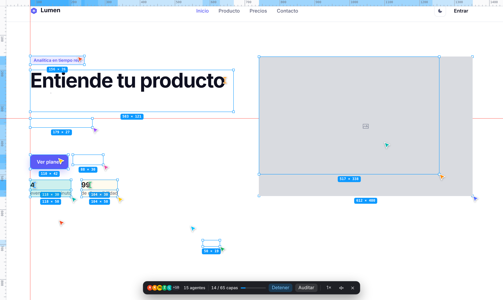

# Swarm QA Browser

Un enjambre de cursores de IA que audita páginas web **en vivo**: decenas de agentes se mueven sobre la página real, seleccionan elementos como en una herramienta de diseño, registran hallazgos anclados al DOM, aplican parches de prueba y vuelven a verificar. Todo se controla desde cualquier cliente MCP (Antigravity, Claude Code, Cursor, Codex) o desde la línea de comandos.




## Qué hace

| Capacidad | Detalle |
| :--- | :--- |
| **Enjambre en tiempo real** | Hasta 32 cursores animados a la frecuencia de refresco de la pantalla, con trayectorias curvas, cajas de selección con tiradores y medidas, reglas y guías. |
| **Tour de reconstrucción** | Oculta las capas de la página y el enjambre las reconstruye una a una (texto "tecleado", imágenes con marcador gris, scroll automático). Es reversible: la página queda idéntica al terminar o al detenerlo. |
| **Auditoría del DOM** | Desbordes horizontales, solapamientos, nombres accesibles, etiquetas de formulario, imágenes rotas, áreas táctiles menores de 44 px y errores de consola o red. |
| **Tickets con ciclo de vida** | `open → claimed → awaiting_reverify → verified / reopened / escalated` (máximo 3 rondas), con pines que siguen a su elemento al hacer scroll. |
| **Auto-sanación verificada** | Aplica un parche reversible, re-audita y solo lo conserva si el hallazgo desaparece; si no, lo revierte. |
| **Interacción real** | Clics y teclado `isTrusted: true`, emulación de viewport y navegación, protegidos por un candado por pestaña. |

## Inicio rápido (sin instalar nada en el navegador)

```bash
npm install
npm run demo
```

Abre <http://127.0.0.1:5173>. En la barra inferior pulsa **Tour** o **Auditar**. Añade `?tour=1` para arrancar el tour al cargar, o `?agents=24&speed=2` para cambiar el enjambre.

## Uso con tu propia aplicación

Hay dos formas de conectar una pestaña al bus local. En ambas el agente usa las mismas herramientas.

### A. Extensión de Chrome (recomendada)

1. `npm install` (genera `packages/extension/overlay.bundle.js`).
2. `npm run start:bus`. La terminal muestra el **código de emparejamiento** (`XXXX-XXXX`).
3. En `chrome://extensions` activa el modo de desarrollador, pulsa **Cargar descomprimida** y elige `packages/extension`.
4. Abre tu aplicación, pulsa el icono de la extensión, escribe el código y pulsa **Vincular** (solo la primera vez).
5. Acepta el consentimiento y pulsa **Habilitar permisos y arrancar enjambre**. Chrome mostrará la barra *"started debugging this browser"* mientras dure la sesión.

### B. Puente CDP (Chromium con depuración remota, webviews, CI)

```bash
chrome --remote-debugging-port=9222 http://localhost:5173
npm run start:bus
npm run start:cdp -- --port 9222 --url localhost:5173
```

## Conectar un agente por MCP

Registra el servidor en tu cliente MCP con la ruta absoluta de tu copia del repositorio:

```json
{
  "mcpServers": {
    "swarm-qa-browser": {
      "command": "node",
      "args": ["/ruta/a/swarm-qa-browser/packages/mcp-server/src/mcp-server.mjs"]
    }
  }
}
```

Si no hay un bus en ejecución, el servidor MCP arranca uno embebido; el código de emparejamiento aparece en `swarm_session_status`.

### Herramientas MCP (22)

| Categoría | Herramientas |
| :--- | :--- |
| Sesión | `swarm_session_status`, `swarm_select_tab`, `swarm_await_event` |
| Enjambre | `swarm_configure_swarm`, `swarm_start_tour`, `swarm_stop_tour`, `swarm_spawn_cursors`, `swarm_move_cursor` |
| Candado e interacción | `swarm_acquire_lock`, `swarm_release_lock`, `swarm_set_viewport`, `swarm_click`, `swarm_fill`, `swarm_press_key`, `swarm_navigate` |
| Auditoría y tickets | `swarm_run_dom_audit`, `swarm_report_finding`, `swarm_list_findings`, `swarm_claim_findings`, `swarm_mark_fixed`, `swarm_verify_finding` |
| Auto-sanación | `swarm_heal_findings` |

## Línea de comandos

Con un bus en ejecución y una pestaña conectada:

```bash
npm run swarm -- status          # pestañas, tickets y código de emparejamiento
npm run swarm -- tour --agents 18 --speed 2
npm run swarm -- audit --follow  # audita y crea tickets; --follow hace scroll hasta cada hallazgo
npm run swarm -- heal            # parchea, re-audita y guarda .qa/heal-report.json y .qa/patches.json
npm run swarm -- watch           # eventos del bus en directo
```

Los parches de `heal` solo viven en la página abierta. `.qa/patches.json` contiene el cambio exacto para llevarlo al código fuente.

## Desarrollo

```bash
npm test            # 55 pruebas unitarias y de integración (node:test + jsdom)
npm run test:e2e    # flujo completo en Chromium real; necesita Playwright
npm run lint
npm run format
```

Para la prueba E2E: `npm i -D playwright && npx playwright install chromium`. Detalles en [docs/testing.md](docs/testing.md).

## Estructura

```text
packages/
  core/             Bus local (HTTP + WebSocket + SSE), tickets, candados, emparejamiento, parches
  overlay/          Motor del enjambre: cursores, selección, reglas, tour, auditor, pines, HUD
  mcp-server/       Servidor MCP por stdio (22 herramientas)
  extension/        Extensión Chrome MV3 (chrome.debugger, consentimiento, emparejamiento)
  cdp-adapter/      Puente CDP para Chromium con depuración remota
  desktop-adapter/  Auditoría de ventanas de Windows (experimental)
  demo/             Página de pruebas con defectos intencionales
scripts/            Build del overlay, demo, CLI `swarm`
test/               Pruebas unitarias, de integración y E2E
```

## Documentación

- [Arquitectura y modelo de seguridad](docs/architecture.md)
- [Guía de pruebas](docs/testing.md)
- [Hoja de ruta y estado real](PLAN.md)
- [Visión de producto](docs/SWARM_QA_PLATFORM_SPEC.md)
- Checklists: [seguridad](docs/checklists/security.md), [UX](docs/checklists/ux.md), [pruebas](docs/checklists/tests.md)

## Límites conocidos

- Los tickets viven en memoria: se pierden al reiniciar el bus.
- La auto-sanación tiene recetas para 4 reglas (`overflow-container`, `tap-target-size`, `a11y-accessible-name`, `a11y-form-label`); el resto se omite con el motivo indicado.
- Las animaciones usan `requestAnimationFrame`: en una pestaña en segundo plano el tour se pausa. Las auditorías y los comandos siguen funcionando.
- El adaptador de escritorio solo lista y enfoca ventanas de Windows; no dibuja cursores fuera del navegador.
- El repositorio aún no tiene licencia; hasta que se añada una, no es software de código abierto.
