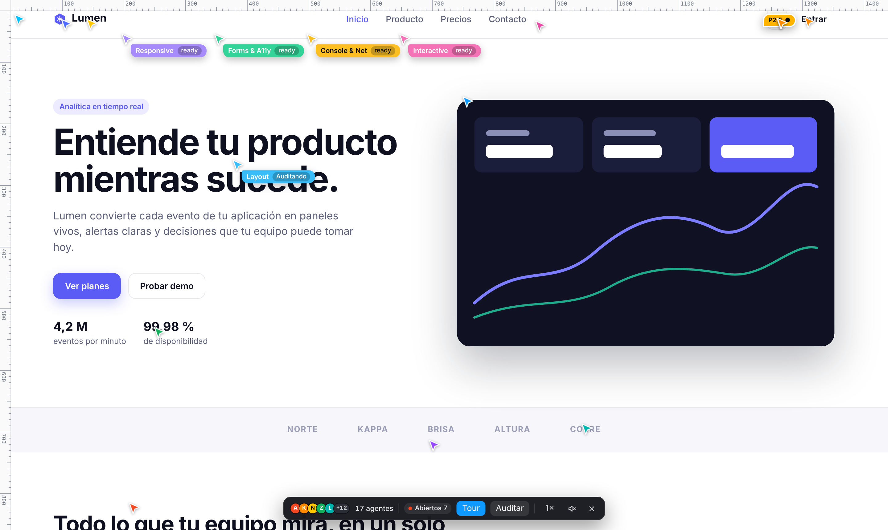

# Swarm QA Browser

Un enjambre de cursores de IA que audita páginas web **en vivo** y una IA que **hace pruebas por sí misma**, tanto en la web como en todo el PC. Decenas de agentes se mueven sobre la página real, seleccionan elementos como en una herramienta de diseño, registran hallazgos, aplican parches y vuelven a verificar. El agente ve la pantalla, usa el ratón y el teclado reales, comprueba resultados y entrega un informe. Todo se controla desde cualquier cliente MCP (Antigravity, Claude Code, Cursor, Codex) o desde la línea de comandos.




## Qué hace

| Capacidad | Detalle |
| :--- | :--- |
| **Enjambre en tiempo real** | Hasta 32 cursores animados a la frecuencia de refresco de la pantalla, con trayectorias curvas, cajas de selección con tiradores y medidas, reglas y guías. |
| **Tour de reconstrucción** | Oculta las capas de la página y el enjambre las reconstruye una a una (texto "tecleado", imágenes con marcador gris, scroll automático). Es reversible: la página queda idéntica al terminar o al detenerlo. |
| **Auditoría del DOM** | Desbordes horizontales, solapamientos, nombres accesibles, etiquetas de formulario, imágenes rotas, áreas táctiles menores de 44 px y errores de consola o red. |
| **Tickets con ciclo de vida** | `open → claimed → awaiting_reverify → verified / reopened / escalated` (máximo 3 rondas), con pines que siguen a su elemento al hacer scroll. |
| **Auto-sanación verificada** | Aplica un parche reversible, re-audita y solo lo conserva si el hallazgo desaparece; si no, lo revierte. |
| **Interacción real** | Clics y teclado `isTrusted: true`, emulación de viewport y navegación, protegidos por un candado por pestaña. |
| **Pruebas dirigidas por IA** | El agente ve la página (captura o esquema), actúa por texto visible ("haz clic en *Entrar*"), espera condiciones, comprueba resultados y genera un informe de aprobado/fallido. |
| **Control total del PC** | Captura de pantalla, ratón y teclado reales, ventanas y apertura de programas, en Windows y Linux (X11). Sin restricciones. |

## Inicio rápido (sin instalar nada en el navegador)

```bash
npm install
npm run demo
```

Abre <http://127.0.0.1:5173>. En la barra inferior pulsa **Tour** o **Auditar**. Añade `?tour=1` para arrancar el tour al cargar, o `?agents=24&speed=2` para cambiar el enjambre.

## Uso con tu propia aplicación

Hay dos formas de conectar una pestaña al bus local. En ambas el agente usa las mismas herramientas.

### A. Extensión de Chrome (recomendada)

1. `npm install` (genera `packages/extension/overlay.bundle.js`).
2. `npm run start:bus`. La terminal muestra el **código de emparejamiento** (`XXXX-XXXX`).
3. En `chrome://extensions` activa el modo de desarrollador, pulsa **Cargar descomprimida** y elige `packages/extension`.
4. Abre tu aplicación, pulsa el icono de la extensión, escribe el código y pulsa **Vincular** (solo la primera vez).
5. Acepta el consentimiento y pulsa **Habilitar permisos y arrancar enjambre**. Chrome mostrará la barra *"started debugging this browser"* mientras dure la sesión.

### B. Puente CDP (Chromium con depuración remota, webviews, CI)

```bash
chrome --remote-debugging-port=9222 http://localhost:5173
npm run start:bus
npm run start:cdp -- --port 9222 --url localhost:5173
```

## Conectar un agente por MCP

Registra el servidor en tu cliente MCP con la ruta absoluta de tu copia del repositorio:

```json
{
  "mcpServers": {
    "swarm-qa-browser": {
      "command": "node",
      "args": ["/ruta/a/swarm-qa-browser/packages/mcp-server/src/mcp-server.mjs"]
    }
  }
}
```

Si no hay un bus en ejecución, el servidor MCP arranca uno embebido; el código de emparejamiento aparece en `swarm_session_status`.

### Herramientas MCP (42)

| Categoría | Herramientas |
| :--- | :--- |
| Sesión | `swarm_session_status`, `swarm_select_tab`, `swarm_await_event` |
| Enjambre | `swarm_configure_swarm`, `swarm_start_tour`, `swarm_stop_tour`, `swarm_spawn_cursors`, `swarm_move_cursor` |
| Orquestación | `swarm_post_message`, `swarm_apply_fix` |
| Ver la página | `swarm_screenshot`, `swarm_snapshot` |
| Actuar en la página | `swarm_click`, `swarm_hover`, `swarm_scroll`, `swarm_fill`, `swarm_press_key`, `swarm_navigate`, `swarm_set_viewport`, `swarm_acquire_lock`, `swarm_release_lock` |
| Verificar | `swarm_wait_for`, `swarm_expect`, `swarm_test_report` |
| Auditoría y tickets | `swarm_run_dom_audit`, `swarm_report_finding`, `swarm_list_findings`, `swarm_claim_findings`, `swarm_mark_fixed`, `swarm_verify_finding`, `swarm_heal_findings` |
| Todo el PC | `swarm_desktop_status`, `swarm_desktop_screenshot`, `swarm_desktop_list_windows`, `swarm_desktop_focus_window`, `swarm_desktop_move`, `swarm_desktop_click`, `swarm_desktop_drag`, `swarm_desktop_scroll`, `swarm_desktop_type`, `swarm_desktop_key`, `swarm_desktop_open` |

## Orquestación: un agente dirige al enjambre

Un agente orquestador (el modelo que uses por MCP) puede dirigir el trabajo completo y dejarlo a la vista en la **bitácora** de la página:

1. **Instruye** al equipo con `swarm_post_message` y reparte los cursores con rol.
2. **Los revisores auditan** (`swarm_run_dom_audit`): cada rol anota sus hallazgos en la bitácora y se crean los tickets.
3. **El orquestador lee el informe** (`swarm_list_findings`) y **decide** ticket a ticket:
   - receta automática → `swarm_heal_findings`;
   - corrección propia → `swarm_apply_fix { ticketId, selector, declarations }`, que se verifica con una re-auditoría y se revierte si no funciona;
   - tickets derivados de la misma causa → `swarm_mark_fixed`, que los re-audita;
   - lo que no se puede arreglar en la página → queda abierto.
4. **Ordena rehacer la página** capa a capa con `swarm_start_tour` y pide una auditoría final.

## Pruebas dirigidas por la IA

El agente sigue el ciclo **ver → actuar → comprobar → informar**. Un ejemplo de lo que puede pedir un agente:

```text
swarm_snapshot                       → qué hay en la página (enlaces, botones, campos y sus valores)
swarm_fill   { text: "Correo", value: "ana@example.com" }   → rellena el campo por su etiqueta
swarm_click  { text: "Entrar" }                             → clic real sobre el botón con ese texto
swarm_expect { text: "Hola, Ana", description: "Saluda al usuario", reportOnFail: true }
swarm_test_report { name: "Inicio de sesión" }              → .qa/test-report-inicio-de-sesion.json
```

- `swarm_expect` reintenta hasta que se cumple o vence el tiempo. Comprueba visibilidad, texto, valor, número de elementos, URL y título.
- Con `reportOnFail`, un fallo se convierte en un ticket `P1` con su pin en la página.
- El informe lista cada acción y cada comprobación. Los valores escritos no se guardan (solo su longitud).

## Control de todo el PC

Las herramientas `swarm_desktop_*` dan al agente la pantalla, el ratón y el teclado del equipo:

```text
swarm_desktop_screenshot                    → imagen de la pantalla (sus píxeles son coordenadas de clic)
swarm_desktop_open  { target: "notepad.exe" }
swarm_desktop_click { x: 640, y: 380 }
swarm_desktop_type  { text: "Hola desde el enjambre" }
swarm_desktop_key   { keys: "ctrl+s" }
```

| Sistema | Requisitos |
| :--- | :--- |
| Windows | Ninguno (usa PowerShell, incluido en el sistema). |
| Linux (X11) | `sudo apt-get install -y xdotool imagemagick`. Wayland no está soportado. |
| macOS | No soportado. |

> **Sin salvaguardas, a propósito.** No hay interruptor de activación, lista de ventanas permitidas ni límite de acciones. Quien pueda llamar al servidor MCP controla el equipo igual que una persona sentada delante: puede abrir programas, escribir en cualquier ventana y ver todo lo que hay en pantalla. Conecta el servidor solo a agentes en los que confíes.

## Línea de comandos

Con un bus en ejecución y una pestaña conectada:

```bash
npm run swarm -- status          # pestañas, tickets y código de emparejamiento
npm run swarm -- tour --agents 18 --speed 2
npm run swarm -- audit --follow  # audita y crea tickets; --follow hace scroll hasta cada hallazgo
npm run swarm -- heal            # parchea, re-audita y guarda .qa/heal-report.json y .qa/patches.json
npm run swarm -- watch           # eventos del bus en directo
```

Los parches de `heal` solo viven en la página abierta. `.qa/patches.json` contiene el cambio exacto para llevarlo al código fuente.

## Desarrollo

```bash
npm test                   # 58 pruebas unitarias y de integración (node:test + jsdom)
npm run test:e2e           # flujo completo en Chromium real; necesita Playwright
npm run test:e2e:desktop   # ratón y teclado reales sobre una ventana visible
npm run lint
npm run format
```

Para la prueba E2E: `npm i -D playwright && npx playwright install chromium`. Detalles en [docs/testing.md](docs/testing.md).

## Estructura

```text
packages/
  core/             Bus local (HTTP + WebSocket + SSE), tickets, candados, emparejamiento, parches
  overlay/          Motor del enjambre: cursores, selección, reglas, tour, auditor, pines, HUD
  mcp-server/       Servidor MCP por stdio (42 herramientas)
  extension/        Extensión Chrome MV3 (chrome.debugger, consentimiento, emparejamiento)
  cdp-adapter/      Puente CDP para Chromium con depuración remota
  desktop-adapter/  Control del PC: pantalla, ratón, teclado y ventanas (Windows y Linux/X11)
  demo/             Página de pruebas con defectos intencionales
scripts/            Build del overlay, demo, CLI `swarm`
test/               Pruebas unitarias, de integración y E2E
```

## Documentación

- [Arquitectura y modelo de seguridad](docs/architecture.md)
- [Guía de pruebas](docs/testing.md)
- [Hoja de ruta y estado real](PLAN.md)
- [Visión de producto](docs/SWARM_QA_PLATFORM_SPEC.md)
- Checklists: [seguridad](docs/checklists/security.md), [UX](docs/checklists/ux.md), [pruebas](docs/checklists/tests.md)

## Límites conocidos

- Los tickets viven en memoria: se pierden al reiniciar el bus.
- La auto-sanación tiene recetas para 4 reglas (`overflow-container`, `tap-target-size`, `a11y-accessible-name`, `a11y-form-label`); el resto se omite con el motivo indicado.
- Las animaciones usan `requestAnimationFrame`: en una pestaña en segundo plano el tour se pausa. Las auditorías y los comandos siguen funcionando.
- El control del PC está probado de extremo a extremo en Linux/X11. El backend de Windows (`win-input.ps1`) está escrito pero **no se ha ejecutado**: compruébalo con `npm run test:e2e:desktop` en tu equipo.
- En el escritorio se mueve el puntero real del sistema; los cursores de colores del enjambre solo se dibujan dentro del navegador.
- El repositorio aún no tiene licencia; hasta que se añada una, no es software de código abierto.
