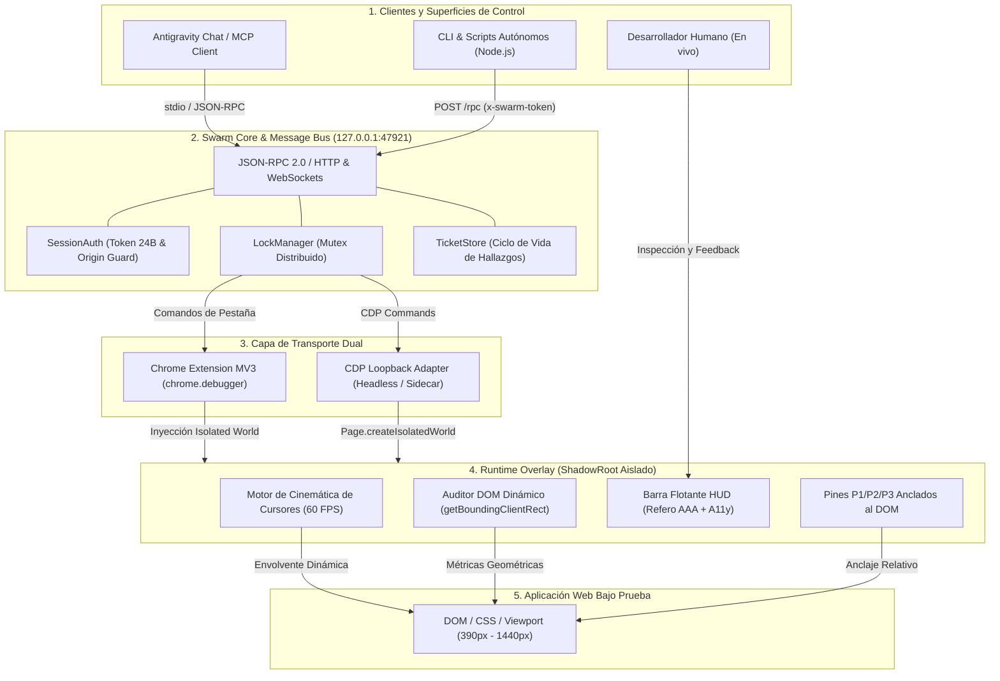
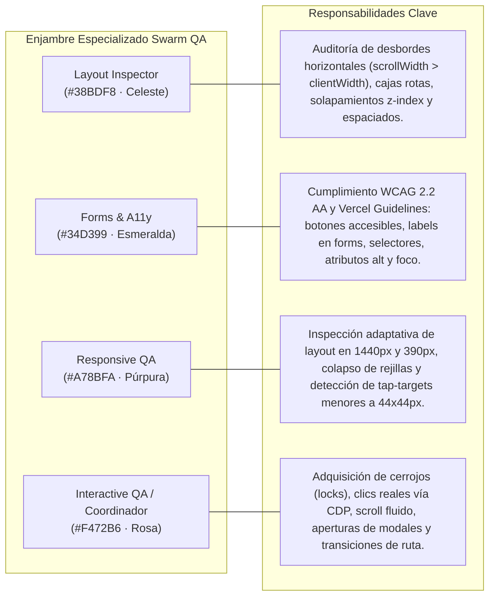
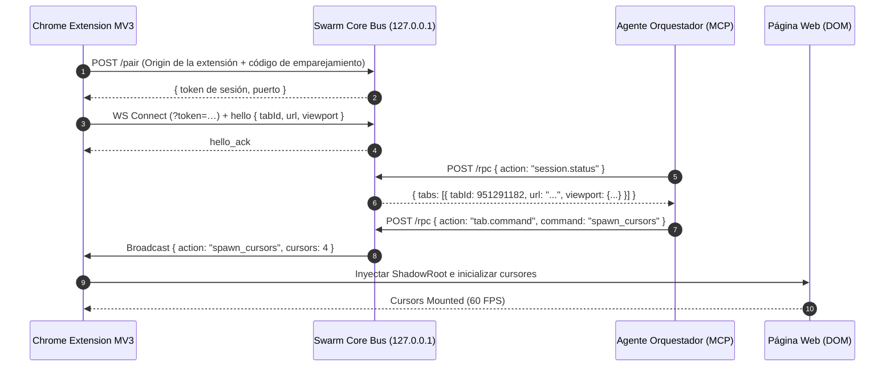
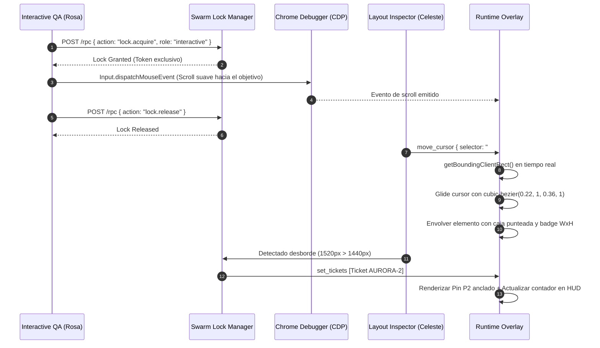
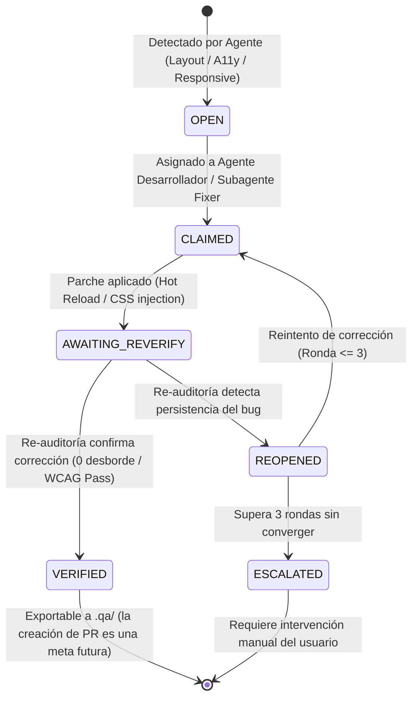
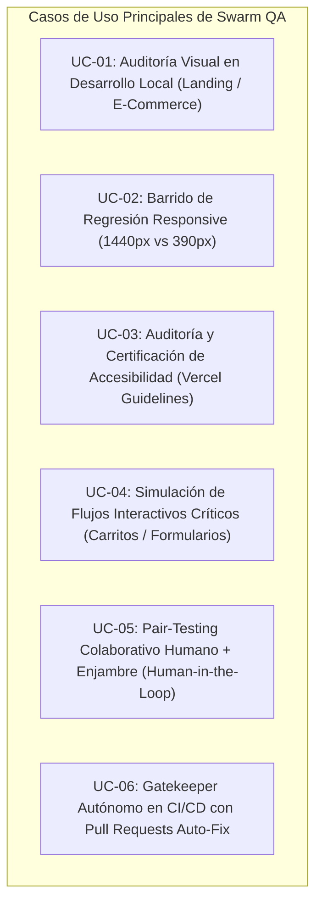

# 🛸 SWARM QA PLATFORM — MASTER BLUEPRINT & PRODUCT VISION
**Plataforma Autónoma Multiagente de Auditoría Visual, Accesibilidad y QA Cinemático**  
*Autor: Brayan Stid Cortés Lombana (`bscl`) & Antigravity Swarm Architecture*  
*Versión: 1.1.0 — Noviembre 2026*

> **Nota de alcance.** Este documento describe la visión del producto. El estado real, con lo que está implementado y probado, está en [PLAN.md](../PLAN.md) y en [docs/architecture.md](architecture.md). Donde ambos difieran, manda el código.

---

## 1. 🌟 Resumen Ejecutivo y Tesis del Producto

### 1.1 El Origen de la Idea
La mayoría de las herramientas modernas de testing visual y automatización web (Selenium, Cypress, Playwright) fueron concebidas bajo el paradigma de la "caja negra": scripts rígidos que interactúan con selectores estáticos, ejecutan aserciones binarias invisibles en terminales frías y fallan catastróficamente ante cualquier rediseño de CSS o refactorización de clases de utilidad.

Por otro lado, la exploración estética de cursores multijugador (`swarm-cursors`) demostró el enorme impacto psicológico y cognitivo de ver múltiples entidades físicas desplazándose de forma coordinada por una interfaz.

**La Gran Tesis de Swarm QA:**
> *"¿Y si transformamos la estética de los cursores multijugador en un enjambre real de agentes de inteligencia artificial autónomos que inspeccionan visualmente la web, auditan desbordes, evalúan accesibilidad, simulan interacción humana y proponen soluciones de código en vivo mientras el desarrollador los observa trabajar?"*

### 1.2 En qué Queremos Convertir Esta Herramienta
Swarm QA Browser está diseñado para consolidarse como la **plataforma líder open-source y de nivel empresarial para aseguramiento de calidad visual autónomo**. 

No es un simple plugin de anotaciones ni una biblioteca de pruebas: es un **entorno de simulación de equipo de QA artificial** compuesto por 4 especialistas concurrentes que viven en el navegador, razonan sobre el árbol del DOM, se desplazan mediante cinemática suave (*Refero AAA*), detectan anomalías en tiempo real y son capaces de cerrar el ciclo de desarrollo generando parches de código correctivo (*Self-Healing QA*).

---

## 2. 🏛️ Arquitectura del Sistema (System Architecture)

La arquitectura sigue los principios de **Minimalismo Pragmático (Ponytail)**, **Aislamiento de Responsabilidad Única (SRP)** y **configuración sin valores quemados**. Se compone de 5 capas desacopladas:

---

## 3. 👥 Taxonomía del Enjambre (Los 4 Agentes Especializados)

El enjambre opera bajo una división estricta del trabajo para erradicar cuellos de botella y maximizar la cobertura:

---

## 4. 🔄 Mapas de Flujo y Secuencias Operativas

### 4.1 Flujo de Handshake, Conexión y Descubrimiento
Este flujo garantiza que cualquier pestaña abierta en Google Chrome o en el panel integrado de Antigravity sea detectada de inmediato sin exponer puertos inseguros hacia la red externa:

---

### 4.2 Flujo de Auditoría Cinemática y Adquisición de Locks
Para prevenir condiciones de carrera cuando un agente necesita hacer clic o desplazar la vista (scroll), se utiliza un gestor de exclusión mutua distribuido (*Lock Manager*):

---

### 4.3 Ciclo de Vida de Hallazgos y Tickets
Cada observación detectada no es texto muerto en consola; sigue una máquina de estados formal que permite su verificación y cierre autónomo:

---

## 5. 🎯 Casos de Uso del Mundo Real (Use Cases)

### UC-01: Auditoría Visual en Desarrollo Local
* **Actor Principal:** Desarrollador Frontend / Diseñador UI.
* **Escenario:** El desarrollador está maquetando una tienda online (ej. Yanbal Prestige o catálogo de productos).
* **Flujo:**
  1. El desarrollador ejecuta `swarm tour` o pide a Antigravity: *"Audita la página de inicio y el catálogo"*.
  2. Los 4 agentes aparecen en la pantalla del navegador visible.
  3. El `Layout Inspector` detecta que las tarjetas de producto no tienen espaciado consistente.
  4. El `Forms & A11y` detecta que el botón del carrito carece de nombre accesible.
  5. Se emite un informe JSON estructurado con el selector DOM exacto para su corrección inmediata.

### UC-02: Barrido de Regresión Responsive
* **Actor Principal:** Agente Responsive QA.
* **Escenario:** Comprobación de una aplicación antes de un lanzamiento masivo.
* **Flujo:**
  1. El agente solicita al `LockManager` emulación de viewport móvil (`390 × 844`).
  2. El enjambre audita elementos interactivos: botones, menús hamburguesa y enlaces.
  3. Detecta elementos con área de toque inferior a `44 × 44px` (infracción de accesibilidad táctil).
  4. Restaura el viewport a escritorio (`1440 × 900`) y certifica la adaptación sin recargar la página.

### UC-03: Auditoría de Accesibilidad (Vercel Web Interface Guidelines)
* **Actor Principal:** Agente Forms & A11y.
* **Escenario:** Auditoría contra directrices de diseño de interfaces web modernas.
* **Flujo:**
  1. El agente recorre todos los elementos de formulario (`input`, `select`, `textarea`, `button`).
  2. Comprueba la presencia de `aria-label`, `<label for="...">` y textos descriptivos.
  3. Verifica que las fuentes numéricas usen `font-variant-numeric: tabular-nums` para tablas de datos y badges de contadores.
  4. Valida soporte para usuarios con `prefers-reduced-motion` silenciando animaciones no esenciales.

### UC-04: Simulación de Flujos Críticos
* **Actor Principal:** Agente Interactive QA.
* **Escenario:** Validación del flujo de registro o compra en una web interactiva.
* **Flujo:**
  1. El agente adquiere cerrojo exclusivo, escribe texto de prueba en inputs de búsqueda y hace clic en botones CTA.
  2. Despliega modales, avanza carruseles y navega entre rutas mediante `history.pushState`.
  3. Monitoriza en tiempo real errores JavaScript (`window.onerror`), promesas no capturadas y peticiones de red fallidas (`HTTP >= 400`).

### UC-05: Pair-Testing Colaborativo (Human-in-the-Loop)
* **Actor Principal:** Desarrollador Humano + Enjambre de IA.
* **Escenario:** Trabajo conjunto de depuración visual.
* **Flujo:**
  1. El usuario está navegando por la web y nota un glitch visual.
  2. Hace clic en un componente o activa el pin de un ticket en la barra HUD flotante.
  3. Los 4 agentes acuden en tiempo real a esa coordenada, rodean el componente con una caja elástica multidimensional y analizan sus propiedades computadas (padding, margen, display, z-index).
  4. El agente le responde al usuario en el chat de Antigravity explicándole exactamente la causa del error.

### UC-06: Gatekeeper Autónomo en CI/CD con Auto-Fix PR
* **Actor Principal:** Runner de GitHub Actions / Vercel Preview.
* **Escenario:** Creación de un Pull Request en un repositorio de producción.
* **Flujo:**
  1. El pipeline de GitHub Actions despliega la rama en un Preview Environment.
  2. Swarm QA Browser se ejecuta en modo headless con emulación CDP.
  3. Audita la ruta modificada. Si encuentra un desborde de 4px en un botón:
     - Genera una rama `fix/overflow-button-cart`.
     - Inyecta la corrección CSS (`max-width: 100%; overflow: hidden;`).
     - Re-audita la página; al verificar 0 errores, abre automáticamente un Pull Request hacia `development`.

---

## 6. 🗺️ Hoja de Ruta Evolutiva (Product Roadmap)

```mermaid
flowchart TD
    M1["Hito 1: Cimientos y Orquestación Cinemática (COMPLETADO)<br/>- Loopback Bus con SessionAuth tokenizada<br/>- Extensión Chrome MV3 y Adaptador CDP<br/>- Overlay ShadowRoot con cursores 60 FPS y HUD Refero AAA<br/>- Erradicación de coordenadas quemadas (100% Selectores Dinámicos)"]
    
    M2["Hito 2: Integración Nativa con LLM y Razonamiento Autónomo (EN CURSO: 22 herramientas MCP disponibles)<br/>- Los agentes no dependen de scripts prefijados: razonan sobre el DOM<br/>- Integración directa con herramientas MCP de Antigravity<br/>- Subagentes especializados (Arquitecto, Dev, QA, DevSecOps)"]
    
    M3["Hito 3: Auto-Sanación en Caliente (PARCIAL: 4 recetas con verificación por re-auditoría)<br/>- Generación automática de parches de estilos e interactividad<br/>- Inyección en caliente y prueba empírica antes de sugerir el cambio<br/>- Creación automática de PRs verificados hacia rama development"]
    
    M4["Hito 4: Grabación Cinemática y Reproducción Visual (Session Replay)<br/>- Exportación de vídeos ligeros y timelines interactivos del recorrido del enjambre<br/>- Comentarios temporizados y anclajes por componente para revisión de producto"]
    
    M5["Hito 5: Plataforma Cloud Enterprise y Suite Colaborativa<br/>- Ejecución masiva distribuida en runners de GitHub Actions y Vercel<br/>- Tablero de control web para equipos de diseño y producto<br/>- SDK multiplataforma (Next.js, Vue, Svelte, Astro, HTML)"]

    M1 --> M2
    M2 --> M3
    M3 --> M4
    M4 --> M5
```

---

## 7. 🛡️ Estándar de Seguridad y Principios de Ingeniería

1. **Aislamiento Perimetral (Zero-Trust Localhost):**  
   El bus de comunicación (`127.0.0.1:47921`) no expone sockets hacia interfaces de red externas (`0.0.0.0`). Cualquier petición HTTP con cabecera `Origin` externa es bloqueada con `403 Forbidden`. Toda llamada RPC requiere un token criptográfico de 24 bytes generado al iniciar el bus, y la extensión solo lo obtiene con el código de emparejamiento.
2. **Protección de Datos Sensibles (Redaction):**  
   Cualquier input de tipo `password` o campo oculto es ofuscado automáticamente como `[redacted]`. Los datos de páginas no confiables viajan tipados como `untrustedPageData: true`.
3. **Ergonomía Refero AAA & Vercel Guidelines:**  
   Tipografías fluidas, `tabular-nums` en números dinámicos, contrastes pensados para WCAG 2.2 AA (sin certificación formal), accesibilidad en lectores de pantalla mediante `role="status"` y respeto absoluto a `prefers-reduced-motion`.
4. **Respeto a la Filosofía Ponytail:**  
   Archivos fuente de una sola responsabilidad, código modular, cero dependencias pesadas e innecesarias y arquitectura guiada por la simplicidad.

---
*Este documento constituye la especificación canónica y el norte estratégico de desarrollo de **Swarm QA Platform**.*
